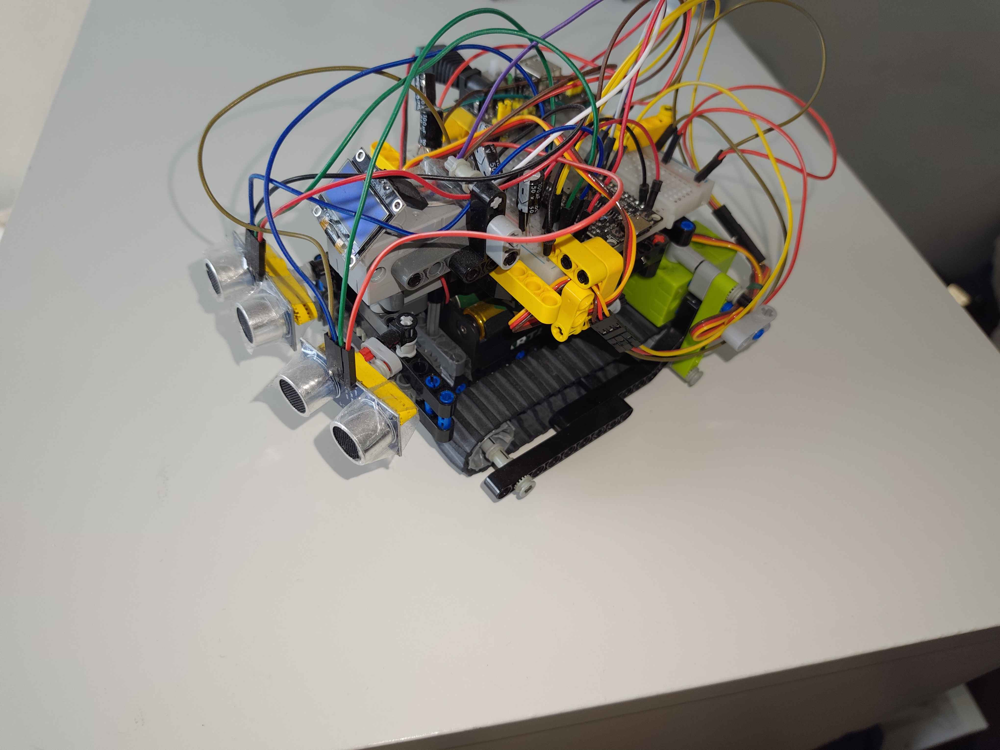
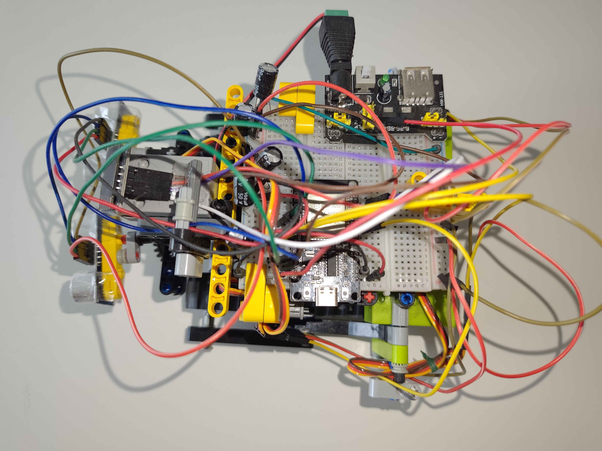
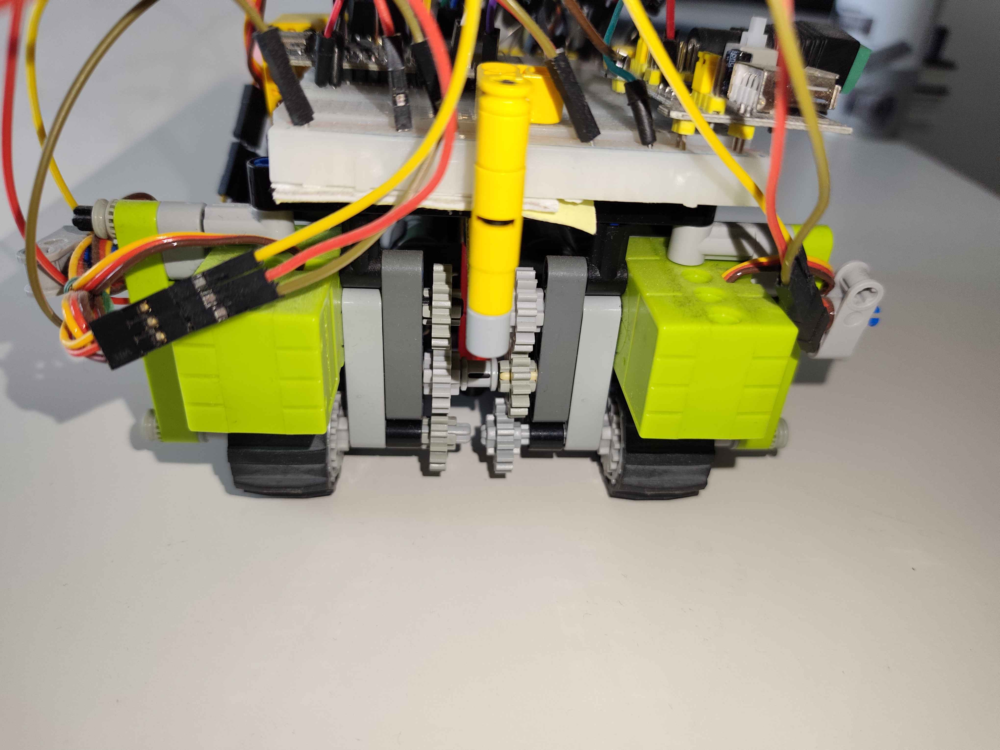

# Autonomous Tracked Robot with Ultrasonic Radar and On-Device AI (ESP32)

A tracked robot built around an ESP32, equipped with a servo-mounted ultrasonic "radar", Bluetooth gamepad control, and an obstacle-avoidance classifier trained with Edge Impulse.

> **Status: proof of concept.** Manual driving, radar scanning, data collection and on-device AI inference work. The autonomous mode is not complete yet (see [Current limitations](#current-limitations)).

## Photos





## How it works

**Sensing: a dual ultrasonic radar.**
Two HC-SR04 distance sensors are used. One is mounted on a servo that sweeps across 16 angles to build a distance map of the surroundings. The second one is fixed at the front and is used to detect obstacles while driving. Echo timing is measured with hardware interrupts rather than blocking calls, so Bluetooth activity on the ESP32 does not distort the distance readings.

**Driving: continuous-rotation servos.**
The two tracks are driven by continuous-rotation servos controlled through PWM (ESP32Servo), with a dead zone on the joystick input and a safety stop when the gamepad disconnects.

**Control: Bluetooth gamepad.**
An Xbox controller is connected over Bluetooth with the Bluepad32 library. Each stick controls one track (tank-style steering).

**AI: obstacle-avoidance classifier.**
The 16-point distance scan is fed to a classifier trained with Edge Impulse and exported as an Arduino library, so the decision runs directly on the ESP32 with no external computer. The prediction is only returned if its confidence is high enough, otherwise the result is `INCERTAIN`.

**Autonomous mode: state machine.**
The autonomous behavior is implemented as a state machine: `DRIVING` → `OBSTACLE_DETECTED` → `SCANNING` → `DECIDING`. The robot drives forward until the fixed sensor sees an obstacle closer than 30 cm, stops, sweeps the radar, and asks the AI model for a decision.

## Gamepad controls

| Input | Action |
|---|---|
| Left stick / right stick | Drive the left / right track (manual mode) |
| **B** | Switch between manual and autonomous mode |
| **A** | Run a radar scan and print the distances over serial (used to build the training dataset) |
| **Y** | Run a radar scan and print the AI decision |
| **X** (held) | Stream dummy data over serial so the Edge Impulse data forwarder can detect the device |

## Hardware

- ESP32
- 2 × continuous-rotation servos (tracks)
- 1 × servo for the radar
- 2 × HC-SR04 ultrasonic sensors (one on the rotating radar, one fixed)
- Xbox Bluetooth controller
- Tracked chassis and battery pack
- 6 AA batteries

Pin assignment (in `ChenilleRadar/Config.h`):

| Component | Pin |
|---|---|
| Radar servo | 18 |
| Left / right track motor | 26 / 27 |
| Rotating sensor (TRIG / ECHO) | 13 / 12 |
| Fixed sensor (TRIG / ECHO) | 32 / 35 |

## Software and libraries

- Arduino framework for ESP32 (C++)
- [Bluepad32](https://github.com/ricardoquesada/bluepad32) (gamepad)
- ESP32Servo
- Edge Impulse (data collection and model training)

## Repository structure

```
ChenilleRadar/
├── ChenilleRadar.ino   # Main loop and mode switching
├── Config.h            # Pin assignment
├── Controller.*        # Bluetooth gamepad handling
├── Motors.*            # Track motor control
├── Radar.*             # Servo sweep and ultrasonic measurement
└── Autonomous.*        # Autonomous state machine and AI inference
images/                 # Photos of the robot
```

## Build and flash

1. Install the ESP32 board package and the Bluepad32 board package in the Arduino IDE.
2. Install the **ESP32Servo** library.
3. Install the Edge Impulse inference library for your model as a `.zip` library (the code includes `Temmie33-project-1_inferencing.h`). It is not included in this repository, because it must be exported from your own Edge Impulse project.
4. Open `ChenilleRadar/ChenilleRadar.ino`, select your ESP32 board, and upload.
5. Power the robot, put the Xbox controller in pairing mode, and drive.

## Training your own model

1. Drive the robot manually and press **A** at different positions to print a scan over serial.
2. Collect these readings in an Edge Impulse project (with the data forwarder, or by copying the values).
3. Label them according to the desired decision and train the classifier.
4. Export the project as an Arduino library and install it as described above.

## Current limitations

- In autonomous mode, the robot stops and prints the AI decision, but does not yet turn or resume driving based on it.
- The model's labels and accuracy depend on the dataset collected, which is small.

## Possible improvements

- Execute the AI decision (turn left/right, back up) and loop back to `DRIVING`.
- Use odometry or an IMU to track heading during turns.
- Collect a larger and more varied dataset.

---

*This README was written with the help of Claude (Anthropic).*
